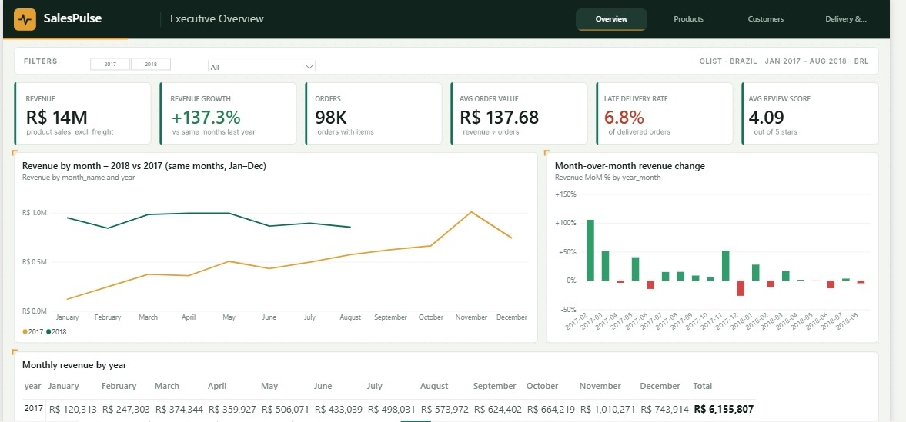
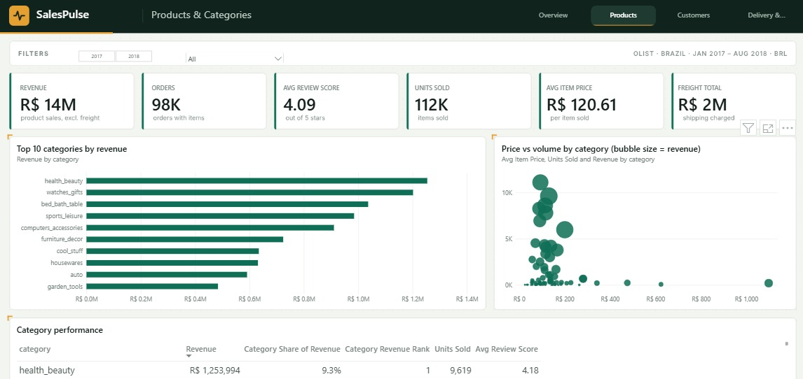
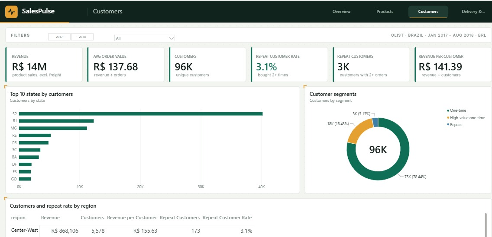
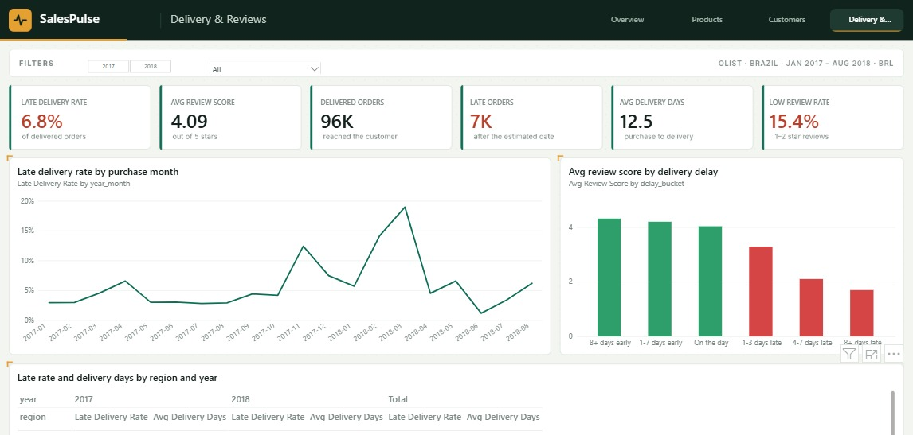
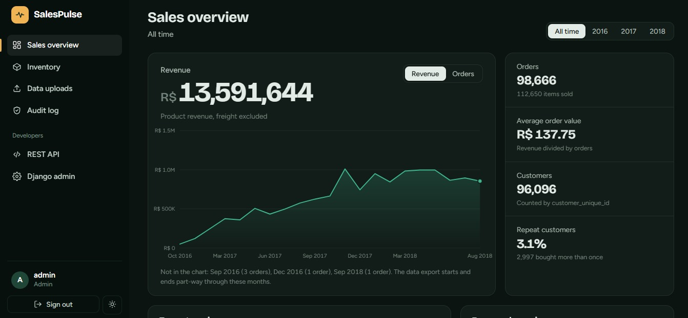
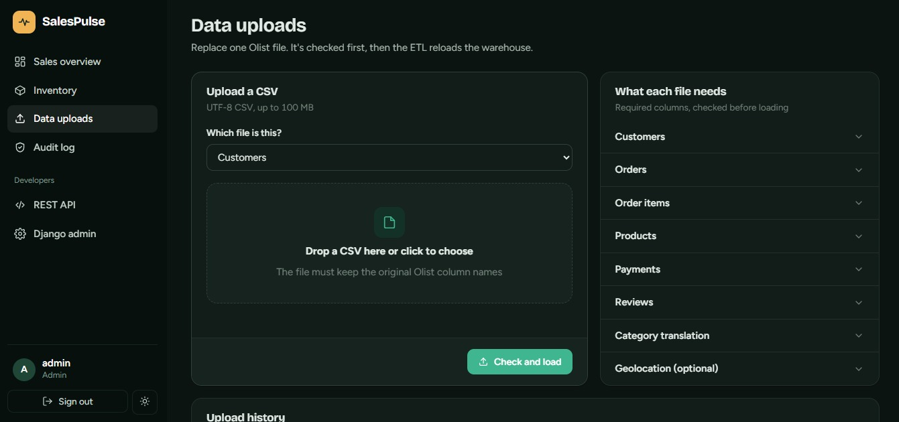
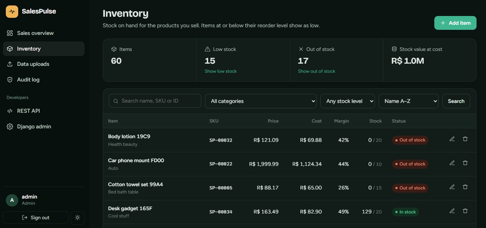
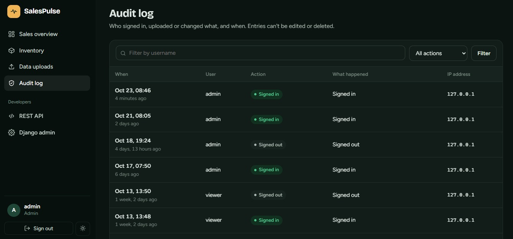
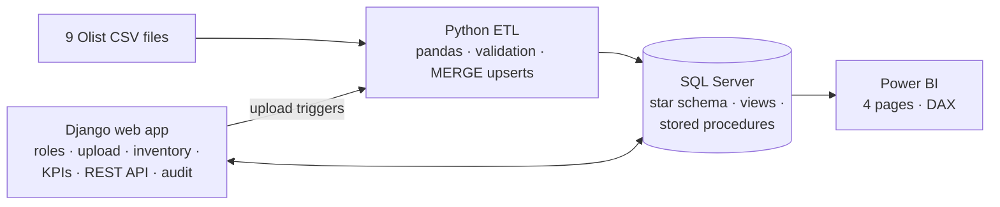
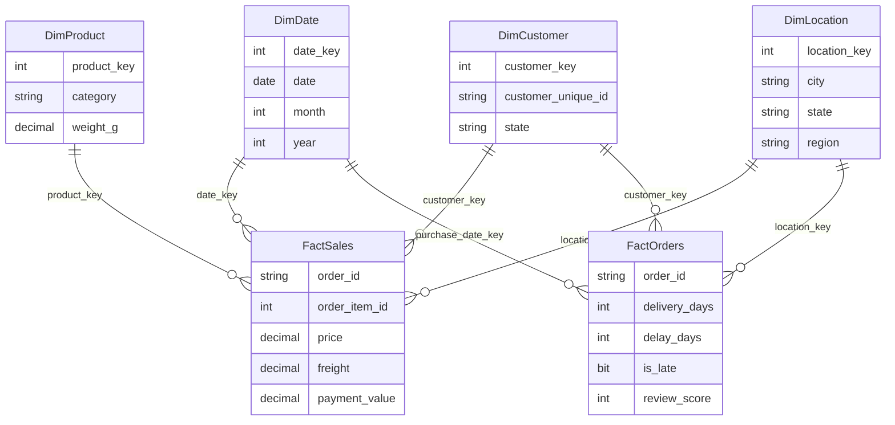

<h1 align="center">SalesPulse — Sales &amp; Inventory Analytics Platform</h1>

<p align="center">
  End-to-end analytics project on ~100K real e-commerce orders:<br/>
  <b>Python ETL → SQL Server star schema → Power BI dashboard + Django web app</b>
</p>

<p align="center">
  
  
  
  
  
  
</p>

<p align="center">
  <a href="#-power-bi-dashboard">Power BI</a> ·
  <a href="#-key-insights">Insights</a> ·
  <a href="#-architecture">Architecture</a> ·
  <a href="#-run-it-locally">Run locally</a>
</p>

<p align="center">
  
</p>

---

## 📌 The problem

An online marketplace has order, payment, delivery and review data spread across **9 raw CSV files**.
Management wants to know: *How is revenue trending? Which categories drive sales? Who are our customers?
And does late delivery hurt our ratings?*

**SalesPulse** answers this end to end: it validates and cleans the raw data, loads it into a
SQL Server data warehouse, and serves the answers through an interactive Power BI report and a
secure, role-based web application.

## 💡 Key insights

| | Finding |
|---|---|
| 📦 | **98,666 orders** analysed, generating **R$ 13.59M** in product revenue |
| 🚚 | **6.8%** of delivered orders arrived late |
| ⭐ | Late orders average **2.3★** vs **4.3★** for on-time orders, so **delivery speed is the biggest driver of customer satisfaction** |
| 🔁 | Only **~3%** of customers ever order again, so retention is a clear growth opportunity |
| ⭐ | Overall average review score: **4.09 / 5** |

*Revenue = sum of item price (freight reported separately). Amounts in Brazilian reais (R$).*

## 📊 Power BI dashboard

Four pages with synced year and region slicers, page navigation buttons, and a custom theme.
The report file is included: [`powerbi/SalesPulse.pbix`](powerbi/SalesPulse.pbix). Open it in Power BI Desktop (free).

| Overview | Products |
|---|---|
|  |  |
| **Customers** | **Delivery & Reviews** |
|  |  |

- **Overview:** revenue, orders, AOV, YoY %, YTD, monthly trend vs previous year, MoM % change
- **Products:** top/bottom categories, price-vs-volume scatter, category share & rank
- **Customers:** unique and repeat customers, revenue per customer, segments, top states
- **Delivery & Reviews:** late-delivery rate over time, review score by delay bucket, region × year matrix

**DAX highlights** ([`measures.dax`](powerbi/measures.dax)): time intelligence (`TOTALYTD`, `SAMEPERIODLASTYEAR`, `DATEADD`),
`USERELATIONSHIP` on an inactive delivery-date relationship, and repeat-customer logic on `customer_unique_id`.

## 🖥️ Web application

| KPI dashboard | CSV upload + ETL |
|---|---|
|  |  |
| **Inventory** | **Audit log** |
|  |  |

- **Role-based access:** Admin, Analyst, Viewer, with a single permission matrix (`roles.py`)
- **KPI dashboard** driven by SQL Server views and stored procedures, with year filter and like-for-like comparison
- **CSV upload** that validates the file, archives the old version and runs the ETL in the background
- **Inventory CRUD** with search, filters, stock status and margin
- **Audit log** of sign-ins, uploads, ETL runs and every inventory change (field-level diff)
- **REST API** (Django REST Framework): `/api/sales-summary/`, `/api/categories/`, `/api/top-products/`, `/api/inventory/`
- **23 automated tests** covering roles, CRUD, audit, upload validation and the API
- Light/dark theme, with matching skins for Django admin and the browsable API

## 🏗️ Architecture



### Star schema



`FactSales` holds one row per order item; `FactOrders` holds one row per order, with the delivery, payment
and review facts that don't belong at item level.

## ⚙️ What's under the hood

**ETL pipeline** ([`etl/`](etl))
- Validates every file: required columns, missing keys, duplicates, bad dates/numbers, negative amounts, out-of-range review scores, orphan rows
- Cleans text (removes accents so customer cities match geolocation), translates categories, drops geo points outside Brazil
- Builds a continuous calendar table for time intelligence
- Allocates each order's actual payment across its items
- Loads through staging tables + `MERGE` on natural keys, so **re-runs are idempotent**
- Logs every run to `EtlRunLog` (rows read / loaded / rejected + JSON data-quality report)

**SQL Server** ([`sql/`](sql))
- Star schema with primary/foreign keys, unique constraints and covering indexes
- **8 views:** KPI summary, monthly revenue (running total, YTD, `LAG` MoM), category ranking, product ranking per category, customer metrics, customer segments (`NTILE`), delivery performance, review vs delay
- **5 stored procedures:** KPI summary, monthly revenue, top-N products, category performance, region sales
- **Analysis queries:** moving averages, YoY with `LAG(12)`, `ROW_NUMBER`, `LEAD`, `PERCENTILE_CONT`, cohort retention

## 🧰 Tech stack

| Layer | Tools |
|---|---|
| Data processing | Python, pandas, NumPy, SQLAlchemy, pyodbc |
| Database | SQL Server (T-SQL, views, stored procedures, window functions) |
| BI / reporting | Power BI Desktop, DAX, star-schema data modelling |
| Web | Django 5.2, Django REST Framework, HTML/CSS/JavaScript |
| Testing | Django test framework (23 tests) |

## 📁 Project structure

```
SalesPulse/
├── etl/                  # extract, validate, transform, load (pandas → SQL Server)
├── sql/                  # schema, views, stored procedures, analysis queries
├── powerbi/              # SalesPulse.pbix, DAX measures, build notes
├── webapp/               # Django project (core app: views, API, roles, audit, tests)
├── data/raw/             # put the Kaggle CSV files here (not committed)
├── docs/screenshots/     # images used in this README
├── requirements.txt
└── .env.example          # copy to .env and fill in your values
```

## 🚀 Run it locally

**Requirements:** Windows, Python 3.11+, SQL Server 2016 SP1+ (Express is fine), ODBC Driver 18, Power BI Desktop.

```powershell
git clone https://github.com/HafizaMaryam25/SalesPulse.git
cd SalesPulse
python -m venv .venv
.venv\Scripts\activate
pip install -r requirements.txt
copy .env.example .env          # then edit .env
```

1. Download the [Olist dataset from Kaggle](https://www.kaggle.com/datasets/olistbr/brazilian-ecommerce) and put the CSV files in `data/raw/`.
2. In SSMS run `sql/01_create_schema.sql`.
3. Load the data: `python -m etl.etl_pipeline` (add `--dry-run` to validate without a database).
4. In SSMS run `sql/02_views.sql`, then `sql/03_stored_procedures.sql`.
5. Start the web app:
   ```powershell
   cd webapp
   python manage.py migrate
   python manage.py setup_roles --demo-users --password "Choose-A-Strong-One1"
   python manage.py seed_inventory --count 60
   python manage.py runserver
   ```
6. Open http://127.0.0.1:8000 and sign in as `admin`, `analyst` or `viewer`.

Run the tests with `python manage.py test core`. Set `DB_ENGINE=sqlite` in `.env` to run them without SQL Server.

## 📝 Notes and limits

- Olist has **no cost, stock or product-name data**. Inventory rows are generated by `seed_inventory`, and the optional profit measures in `measures.dax` are an **estimate** driven by a What-if COGS % parameter.
- In Olist, `customer_id` is unique per order; the real customer is `customer_unique_id`, which is what all repeat-customer metrics use.
- The background ETL thread suits a single-server demo; production would use a task queue (Celery / Django-Q).

## 📚 Data source

[Brazilian E-Commerce Public Dataset by Olist](https://www.kaggle.com/datasets/olistbr/brazilian-ecommerce) (Kaggle).
The raw CSV files are not committed to this repository; download them from Kaggle.

## 👤 Author

**Hafiza Maryam** · [LinkedIn](https://www.linkedin.com/in/hafizamaryam/) · [Email](mailto:imhafizamaryam@gmail.com)

*Open to Data Analyst / BI Developer roles.*